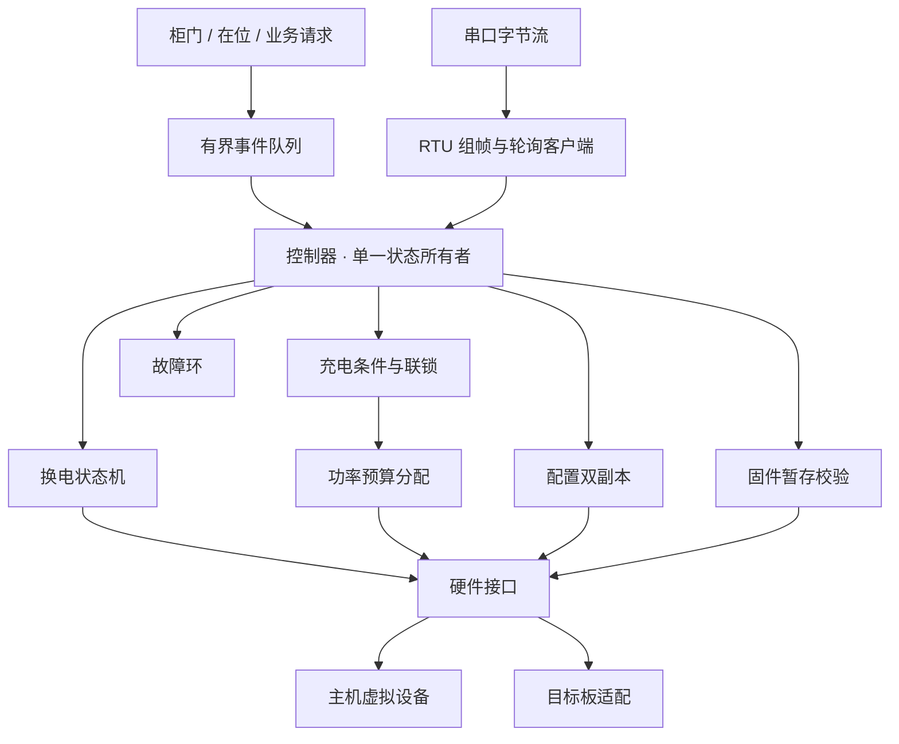

# Cabinet Controller

多仓充换电控制器 · C11 / Modbus RTU / FreeRTOS

[](https://github.com/FFcodelab/Cabinet/actions/workflows/build.yml)
[](LICENSE)

面向多仓设备的控制软件，包含电池数据轮询、柜门联锁、换电流程、整柜功率分配、参数持久化与固件暂存校验。控制逻辑与硬件接口分离，可在 PC 上运行场景仿真，也可通过适配层接入 FreeRTOS。

本仓库为独立实现，采用自定义虚拟设备和寄存器映射。当前可运行版本是四仓主机仿真，尚未完成实际控制板移植与实物联调。

## 核心功能

| 模块 | 实现内容 |
| --- | --- |
| 设备通信 | Modbus RTU 03 功能码、CRC16、流式收包、单请求轮询、超时与有限重试、异常响应处理 |
| 数据处理 | 电压、电流、SOC、温度、状态字及功率上限解码；范围检查与数据过期判断 |
| 换电控制 | 归还仓与取电仓预检查，开门、入仓、关门、取电的分阶段状态机及阶段超时 |
| 充电调度 | 在整柜预算内分配各仓功率，未用额度再分配，小额余量按周期轮换 |
| 安全联锁 | 开门、无电池、故障、温度越界、数据失效及升级接收时禁止对应充电输出 |
| 配置存储 | 双副本、版本号、递增序列、CRC32 与写后校验；重新加载时选择有效记录 |
| 固件暂存 | 顺序分块、长度与偏移校验、接收超时、流式 CRC32 和存储读回校验 |
| 运行管理 | 有界事件队列、固定容量故障环、输出错误与队列溢出的停充锁存 |
| 系统适配 | 单任务持有控制对象，ISR 队列投递，原子溢出标志及互斥快照 |

## 架构



| 目录 | 职责 |
| --- | --- |
| `include/cabinet/` | 类型定义与模块接口 |
| `src/domain/` | 采样、联锁、换电与功率分配 |
| `src/protocol/` | CRC、Modbus 报文与字节流组帧 |
| `src/services/` | 轮询、队列、故障记录与升级接收 |
| `src/storage/` | 配置编解码与双副本存储 |
| `src/app/` | 业务编排、输出控制和接口入口 |
| `ports/host/` | 虚拟串口、柜门、电池、存储与故障注入 |
| `ports/freertos/` | FreeRTOS 任务与中断接入 |
| `apps/simulator/` | 场景执行与 JSON 轨迹输出 |
| `tests/` | 协议、领域逻辑、存储、升级及整机控制测试 |
| `docs/` | 设计、协议、接入与验证说明 |

## 快速运行

需要 Python 3.9+ 与 GCC/Clang。主机版本没有第三方运行库依赖。

```bash
python tools/build.py
```

Windows 可指定编译器：

```powershell
python tools/build.py --cc "C:/MingW/mingw64/bin/gcc.exe"
```

构建脚本启用严格编译警告，执行四组测试与两条场景，并检查输出轨迹。结果位于 `build/`：

| 文件 | 内容 |
| --- | --- |
| `cabinet_sim` / `cabinet_sim.exe` | 仿真程序 |
| `normal.json` | 完整换电、固件暂存和配置变更轨迹 |
| `fault.json` | 在正常流程中加入设备掉线与恢复 |
| `verification.json` | 编译器与通过的检查项 |

也可单独运行，程序将结果写入指定 JSON 文件，不输出业务调试日志：

```bash
./build/cabinet_sim normal build/normal.json
./build/cabinet_sim fault build/fault.json
```

使用 CMake：

```bash
cmake -S . -B build-cmake -DCMAKE_BUILD_TYPE=Release
cmake --build build-cmake --parallel
ctest --test-dir build-cmake --output-on-failure
```

Windows 的 MinGW Makefiles 生成器可能不能正确处理中文路径。遇到路径乱码时，将工程与 CMake 工具放到纯英文路径；上面的 Python 构建方式不依赖 Makefile。

Linux 上可增加内存与未定义行为检查：

```bash
python tools/build.py --sanitize
```

## 关键设计

- 控制对象由单个执行上下文持有。通信回调、事件消费和控制步骤按顺序执行，避免多个任务直接修改仓位状态。
- 一次只保留一个 RTU 请求，最多重试两次；错误或过期数据不会继续参与充电决策。
- 开锁前先对目标仓下发零功率，零功率命令失败时不继续开锁。
- 功率分配先执行联锁，再分配预算；每仓输出不超过需求，所有仓的总和不超过整柜预算。
- 配置使用字段级编码，不直接写入 C 结构体，不依赖编译器填充和主机字节序。
- 固件接收成功后还要读取暂存介质重新计算 CRC；状态变为 `READY` 仅表示暂存数据完整。
- 业务核心使用固定容量内存，无动态分配。FreeRTOS 适配层在启动阶段创建任务、队列及互斥锁。

## 接入与边界

`cab_ports_t` 定义串口发送、开锁、功率设定、配置介质及镜像介质接口。仓位在位与门状态由事件输入。真实硬件接入需提供 BSP，并确认串口时序、输出反馈、Flash 擦写与任务资源配置。

FreeRTOS 适配层已提供，主机构建默认不包含它。其启动接口接受硬件端口，串口中断通过队列投递字节块；板级工程需自行提供内核、端口和配置。见 [FreeRTOS 接入](docs/freertos.md)。

当前没有接入真实 BMS、CAN、蜂窝网络、支付平台或量产升级链路。CRC 用于发现数据损坏，不提供身份认证或固件签名；暂存模块不执行镜像，不包含 Bootloader、启动切换与回滚。实际充电保护和紧急断电需要独立的硬件保护与输出反馈。

## 文档

- [架构与状态约束](docs/architecture.md)
- [虚拟设备协议](docs/protocol.md)
- [FreeRTOS 接入](docs/freertos.md)
- [构建、测试与故障场景](docs/verification.md)
- [接口使用](docs/integration.md)

## 参考与许可

Modbus 报文语义参考 [Modbus 官方规范入口](https://www.modbus.org/modbus-specifications)。任务适配使用 [FreeRTOS 官方 API](https://www.freertos.org/Documentation/02-Kernel/04-API-references/06-Queues/04-xQueueSendFromISR)，头文件兼容性检查采用 [FreeRTOS-Kernel V11.2.0](https://github.com/FreeRTOS/FreeRTOS-Kernel/releases/tag/V11.2.0)。内核源码未随仓库分发。

本仓库代码使用 [MIT License](LICENSE)。
