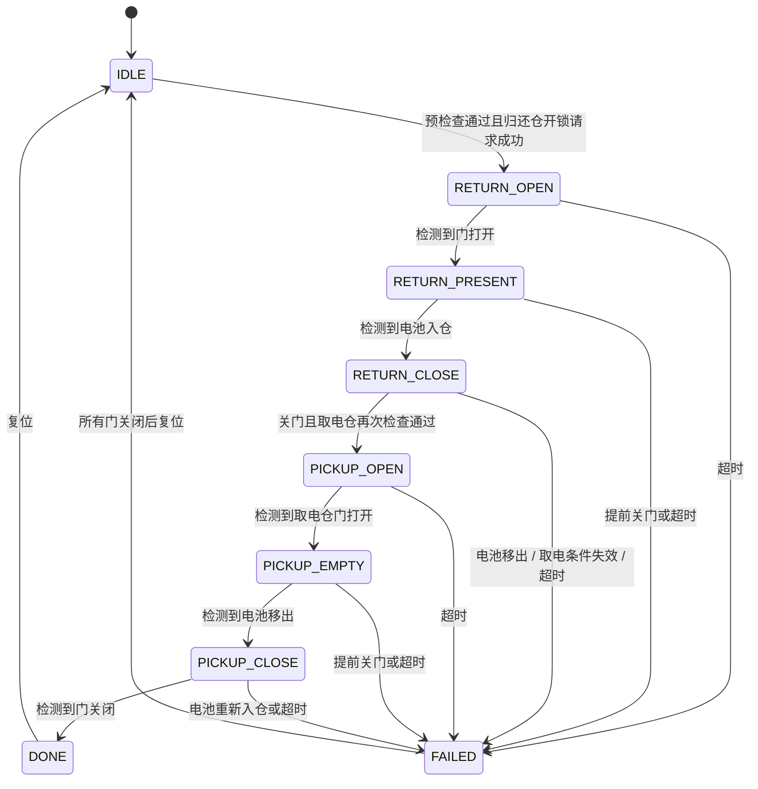

# 架构与状态约束

## 执行模型

所有 `cab_controller_*` 接口必须在同一个任务或串行事件循环中调用。核心内部的事件队列不是线程安全队列，也不用于中断直接访问。FreeRTOS 适配层使用内核队列隔离生产者，再由控制任务调用这些接口。

一次控制步骤按顺序处理：

1. 消费最多 32 个业务事件，并在每个事件之后推进换电状态，保留同一周期内多个门状态边沿的顺序。
2. 推进通信事务、换电阶段超时和升级接收超时。
3. 计算各仓允许的功率需求。
4. 执行预算分配，调用输出接口。
5. 输出调用失败时锁存停止状态，再向全部仓位请求零功率。

串口发送接口只应复制或提交发送请求，不能同步回调接收接口。收到的字节应在后续循环或队列消息中送入控制器，避免重入。

## 换电状态机

起始要求：归还仓为空且关门；取电仓在位、关门、采样有效且未过期、SOC 达标、温度合格、状态正常。开取电仓之前再次检查。业务调用方决定归还与取电仓位，当前没有用户认证、支付或订单模块。

参与换电的两个仓位在流程中停止充电。失败后继续保留这两个仓位，直到所有门关闭并执行流程复位。控制器级别的输出错误、事件溢出锁存不能通过流程复位清除，只能由上层确认故障处理完成后重新初始化。

## 功率分配

先过滤不允许充电的仓位，再对剩余需求做等额分配；低需求仓位的剩余额度会重新分给其他仓位。不能整除的少量额度优先从游标仓位开始分配，游标每 1000 ms 轮换一次。

分配函数保证：

- `0 <= output[i] <= demand[i]`。
- 总输出为 `min(总需求, 整柜预算)`。
- 零需求仓位始终得到零功率。

这里输出的是功率设定值，不包含具体充电器的电压电流闭环、MOS 控制或 BMS 保护算法。实际输出是否归零需要板级反馈和独立保护确认。

## 时钟与存储

核心使用 `uint32_t` 毫秒时钟，比较采用无符号差值，跨一次回绕仍可计算超时。调用周期必须足够短，不能停顿一个完整的计数周期。配置允许的最长超时为 60000 ms。

配置记录 48 字节，由字段编码而来，包含标识、版本、序列和 CRC32。两个副本由 HAL 映射至互不影响的存储区域；写入目标是非活动副本，写后完整读回。重启扫描两个副本，按有效性和回绕序列比较选取记录。序列比较假定两个存活副本的距离小于 `2^31`。

写接口返回失败时，运行中的配置不切换。若介质实际已经写完但报告失败，重启仍可能选中完整的新记录；双副本机制保证选择通过检查的记录，不承诺所有 I/O 失败后一定恢复旧值。CRC 也不替代认证或硬件原子性。

## 固定容量

| 对象 | 容量 / 限制 |
| --- | --- |
| 仓位 | 4 |
| 业务事件 | 32 |
| RTU 接收缓冲 | 255 字节 |
| 故障环 | 16 条，满后覆盖最旧条目 |
| 主机固件暂存 | 4096 字节 |
| 单次升级分块 | 1–256 字节 |
| FreeRTOS 串口消息 | 1–64 字节，较大数据应拆分投递 |

这些容量用于当前实现，修改仓位数量时需同时调整地址映射、资源预算和验证场景，不能只改宏后直接连接实物。
